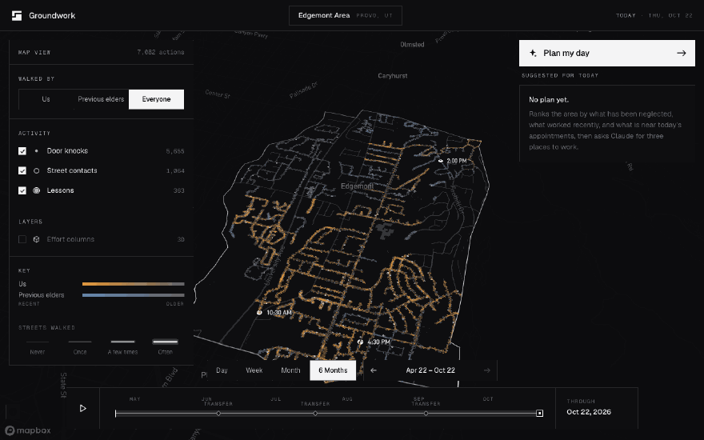

# Groundwork

See where you've been. Know where to go.

Groundwork is a 3D map for missionary companionships that shows where they, and the companionships before them, have walked and worked in their area over the last six months, then suggests where to work today. Walked streets glow by how often they were covered and fade as the work ages, so a street knocked months ago reads as new ground again. A "Plan my day" button ranks the area's zones on neglect, recent success, and walking distance to today's appointments, asks Claude to pick three places with a one-sentence reason each, and draws the walking route from the nearest appointment. History, not surveillance: there are no live locations and no individual tracking.

**Live:** https://groundwork-inky-three.vercel.app



## Demo path

1. Open the live link. The map frames the Edgemont area with the full six months showing.
2. Press play on the timeline. The window grows from April to today, transfer by transfer.
3. Switch **Walked by** to **Previous elders**, then back to **Everyone**.
4. Click **Plan my day**. Three places come back, each labelled Nearby, Repeat what worked, or Neglected, with a reason that cites the numbers.
5. Click a suggestion. The camera flies to the zone, outlines it in white, and draws a dashed walking route from the nearest appointment.

## Stack

- Next.js (App Router), TypeScript, Tailwind
- Mapbox GL JS v3 for the basemap and walking directions
- deck.gl via `MapboxOverlay` for walked streets, actions, hex columns, and routes
- h3-js and Turf for spatial work
- Anthropic SDK (Claude) from a server route for suggestions
- Vercel for hosting, deploying from `main`

## Data

All data is synthetic. `scripts/generate.ts` builds six months of walks and door knocks on real residential streets from an OpenStreetMap extract of the Edgemont neighborhood in Provo, Utah, clipped to a boundary that follows real roads and the Provo River. Four patterns are planted for the planner to find, and `scripts/validate.ts` checks them along with the data's integrity. No real people, visits, or addresses are represented.

```bash
npm run generate     # rebuild public/data/*.json from scripts/data/osm-roads.json
npm run validate     # check bounds, timestamps, references, and planted patterns
npm run check-plan   # call /api/plan five times and check the planted patterns come back
```

`check-plan` expects a running app on port 3100; set `PLAN_URL` to point it elsewhere.

## Run locally

```bash
cp .env.example .env.local   # add NEXT_PUBLIC_MAPBOX_TOKEN and ANTHROPIC_API_KEY
npm install
npm run dev
```

Without an Anthropic key, Plan my day falls back to the deterministic ranking with templated reasons. Without a Mapbox token, the app shows a notice in place of the map.

## Layout

- `app/` routes, layout, metadata, icons, and the `/api/plan` route
- `components/map/` Mapbox and deck.gl layers
- `components/panels/` header, left panel, Plan panel
- `components/timeline/` bottom scrubber
- `components/brand/` the mark and lockup
- `lib/data/` types, loaders, time helpers, routing
- `lib/scoring/` zone scoring and plan validation
- `lib/colors/` the only colour in the product, for the map
- `scripts/` data generator, validator, and plan checker
- `brand/` mark options, the chosen mark, and the lockup
- `public/data/` generated JSON

`SPEC.md` is the source of truth for scope and phases. `BUILD_LOG.md` records how it was built.
